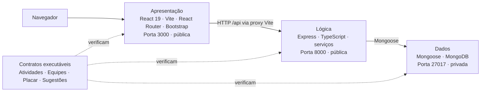

# Arquitetura do OctoFit Tracker

O OctoFit Tracker é uma aplicação de três camadas para um programa de atividades físicas escolar. O código inicial inclui contratos de API e pontos de implementação intencionalmente incompletos para que você use o modo agent do GitHub Copilot em um ciclo guiado por testes.

## Limites entre as camadas

- **Camada de apresentação**: React 19, Vite, React Router, Bootstrap e um cliente compartilhado da API em `octofit-tracker/frontend/src`.
- **Camada de lógica**: rotas e serviços Express com TypeScript em `octofit-tracker/backend/src` expõem o comportamento `/api/*` na porta `8000`.
- **Camada de dados**: modelos Mongoose e dados de demonstração em `octofit-tracker/backend/src/models` e `src/scripts/seed.ts` são persistidos no MongoDB na porta `27017`.

## Portas e regras de ambiente

- MongoDB: `27017` (privada)
- API Express: `8000` (pública)
- Interface Vite: `3000` (pública)
- O navegador acessa caminhos relativos `/api`. O Vite os encaminha para `http://localhost:8000`; `VITE_API_BASE_URL` pode substituir a URL-base.
- Não encaminhe nem torne públicas outras portas.

## Contrato da API

| Capacidade | Método e caminho | Comportamento esperado |
| --- | --- | --- |
| Registro de atividades | `GET /api/activities`, `POST /api/activities` | Lista e cria atividades válidas. POST recebe `userId`, `teamId`, `type` e `minutes`; `userId` e `teamId` devem ser IDs bem-formados de uma pessoa e uma equipe existentes, caso contrário a API retorna um 4xx intencional (nunca um 500 causado por erro de conversão). Uma atividade criada armazena `user`, `team`, `type` e `minutes` enviados, além de `points` e `occurredAt` calculados. |
| Equipes | `GET /api/teams`, `POST /api/teams` | Lista e cria equipes com integrantes. As equipes criadas e listadas mantêm os valores enviados em `name` e `mascot`. Rejeita uma equipe sem nome com `400`. |
| Placar | `GET /api/leaderboard` | Retorna as equipes ordenadas pela soma dos pontos de suas atividades, da maior para a menor. Cada item contém `teamName`, `totalPoints` e uma `rank` iniciada em 1. |
| Sugestões de treino | `GET /api/workouts/suggestions/:userEmail` | Recomenda treinos com base nos padrões de atividade recentes da pessoa correspondente ao e-mail seed. O foco da primeira sugestão (`focus`) corresponde à meta ou à atividade recente dessa pessoa, e o campo `reason` explica o motivo. Um e-mail sem pessoa correspondente retorna um 4xx intencional (por exemplo, `404`). |

## Decisões de implementação

- **Camada de apresentação:** componentes React consomem a API pelo cliente compartilhado em `src/api/client.ts`. Um componente comum apresenta estados acessíveis de carregamento, erro e vazio; cada capacidade renderiza seus dados em lista ou tabela.
- **Camada de lógica:** rotas Express delegam aos serviços, que validam entradas e referências antes de persistir. Entradas malformadas retornam `400`; referências inexistentes retornam `404`.
- **Camada de dados:** esquemas Mongoose exigem os campos essenciais; minutos devem ser positivos e pontos não negativos. O seed permanece baseado em upserts idempotentes e reconcilia a equipe anterior da pessoa de demonstração.
- **Registro de atividades:** validar IDs como strings antes de consultar o MongoDB e confirmar a existência da pessoa e da equipe. Calcular pontos com base nos minutos e registrar `occurredAt` no momento da criação.
- **Gerenciamento de equipes:** exigir nome e mascote, validar todos os IDs dos integrantes e manter a associação pessoa-equipe sincronizada ao criar a equipe.
- **Placar:** agregar pontos por equipe, incluir equipes sem atividades com zero pontos e ordenar por total decrescente, atribuindo posições a partir de 1.
- **Sugestões de treino:** localizar a pessoa pelo e-mail, considerar até cinco atividades recentes, mapear corrida, ciclismo e caminhada para resistência e priorizar treinos compatíveis com a meta; incluir um motivo em cada sugestão.

## Plano de testes

- **Falhas iniciais:** `npm test --prefix octofit-tracker/backend` teve 8 falhas e 1 aprovação: validações obrigatórias ausentes nos modelos, operações de atividades/equipes ainda retornando `501`, placar vazio e foco de sugestão incorreto. `npm test --prefix octofit-tracker/frontend` teve 15 falhas porque as telas ainda exibiam o estado de implementação pendente em vez de buscar e apresentar os dados e estados da API.
- **Dados:** `npm run test:data --prefix octofit-tracker/backend` — 5 testes aprovados, incluindo validação dos modelos e seed idempotente.
- **API:** `npm run test:api --prefix octofit-tracker/backend` — 4 testes aprovados, cobrindo atividades, equipes, placar e sugestões.
- **Backend completo:** `npm test --prefix octofit-tracker/backend` — 9 testes aprovados.
- **Frontend:** `npm test --prefix octofit-tracker/frontend` — 15 testes aprovados, cobrindo conteúdo e estados de carregamento, vazio e erro.
- **Compilação do backend:** `npm run build --prefix octofit-tracker/backend` — `tsc --noEmit` concluído sem erros.
- **Build do frontend:** `npm run build --prefix octofit-tracker/frontend` — verificação TypeScript e build Vite concluídos sem erros.
- **Falha transitória durante a implementação:** a primeira execução da suíte do frontend não transformou o componente por uma exportação duplicada de `CapabilityCard`; o placeholder remanescente foi removido e a suíte passou na execução seguinte.
